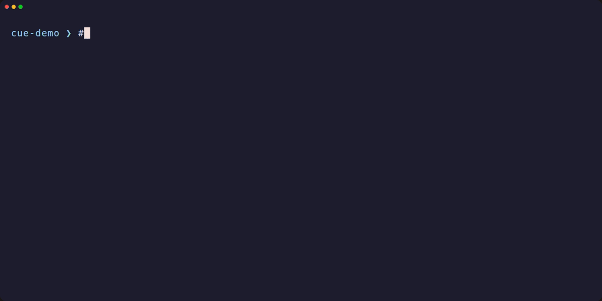

<div align="center">

# cuecards

**Project profiles for Claude Code and Codex.**

Give each repository its own skills, MCP servers, and instructions.<br>
Run the coding agent you already use.

[Agent install](#install-with-an-agent) · [Manual install](#install) · [Profile catalog](#the-catalog) · [Compare tools](#how-it-compares) · [Community](https://cuecards.cc)

[](https://www.npmjs.com/package/cue-ai)
[](LICENSE)

</div>

## Install with an agent

**Copy the prompt below** with the copy button in the top-right of the block.
Paste it into Claude Code, Codex, or another coding agent opened in your project.

```text
Install cue (https://github.com/opencue/cuecards) on this machine and set it up
for this project.

1. Check Node.js 20+, npm, and an installed Claude Code or Codex CLI. Stop and
   tell me if a prerequisite is missing.
2. Check whether cue is already on PATH (`command -v cue`, or `Get-Command cue`
   in PowerShell). If it is, skip to step 4.
3. Ask me before installing anything, then run: `npm install -g cue-ai`
4. Run `cue auto-detect --json`. Show me the profile suggestions it returns and what
   each one is for, and let me pick one — don't choose for me.
5. Explain the project, shim, and PATH changes below. Only after I approve,
   run `cue setup --profile <the one I picked> --yes`. That pins the profile,
   installs the shim that makes `claude`/`codex` load it, and — if needed —
   configures the shim directory on PATH (shell rc on Linux/macOS, Current User
   PATH on native Windows) so the shim takes effect. It will not enable telemetry and will not install
   third-party skills. If it exits non-zero, stop and show me the output
   instead of continuing to step 6.
6. If it prints PATH guidance, show it verbatim — the shims do nothing until that
   line is added.
7. Verify with `cue --version` and `cue current`. Report which profile was
   pinned and whether the shim is active. Mention that `cue shell uninstall`
   undoes the shim, or `npm uninstall -g cue-ai` removes the CLI package.

Do not install anything without asking me first.
```

## Quick start
<a id="install"></a>

Requires Node.js 20+ and an existing [Claude Code](https://github.com/anthropics/claude-code)
or [Codex](https://github.com/openai/codex) installation. In an API repository:

```sh
npm install -g cue-ai
cue setup --profile backend
cue current --plan --agent claude
cue launch claude --cue-profile backend
```

Use `codex` in the last two commands if that's your agent. Setup pins the profile,
installs launch shims, and can update your PATH. Once the shims are on PATH, run
`claude` or `codex` as usual. Optional tooling is not required.

For a global npm installation, interactive starts check for a new Cue version
at most once a day. Press `y` then Enter to update and continue the same command,
or Enter to skip. CI, scripts, and profile previews do not prompt.
Set `CUE_NO_UPDATE_CHECK=1` to turn the check off.
Use `cue update --check` to see the installed and latest npm versions and
release notes on demand. Run `cue update` to confirm and install the update.

The plan shows why Cue selected the profile and lists local, missing, deferred,
and remote resources. To try a profile before pinning anything, run
`cue current --plan --profile backend`. The preview installs and writes nothing.

[Install with an AI agent](setup/agent-prompt.md) · [macOS](setup/macos.md) · [Linux](setup/linux.md) · [Windows](setup/windows.md) · [Shell setup and removal](docs/shell-setup.md)

## Profile demos


These recordings run the real Cue CLI. The Codex process is simulated: it
checks that Cue handed it a generated config, then prints a sample response.
The recordings use local resources only and make no model calls.

### Start with `core`

`cue launch codex --cue-profile core` skips the picker and starts with the
baseline profile.


### Stack `backend` and `frontend`

`cue launch codex` opens the picker. Press `/` to search, Space to add or remove
a profile from the stack, and Enter to launch with the selection.



To re-record, [set up the development checkout](CONTRIBUTING.md), then run
`vhs docs/demos/core.tape` and `vhs docs/demos/stack.tape` from its root with
[VHS](https://github.com/charmbracelet/vhs).

## How it works

A **cuecard** is a reusable profile. For example, pin `backend` in an API repo
and `frontend` in a web app. Cue prepares each profile's runtime and starts
your existing agent with it. No daemon. [See the launch flow](docs/launch.md).

The picker can suggest profiles and skills from project signals; it installs
nothing. Set `CUE_PROFILE_ADVISOR=off` for local-only matches.

## The catalog

Start with `core` for a minimal baseline, `backend` for API work, or
`frontend` for UI work. Use `cue auto-detect` for a suggestion, or `cue list`
to browse available profiles. [See the full catalog](docs/data/profiles.md).

### Share a profile

```sh
cue export backend --portable --output team.cue.yaml
cue import team.cue.yaml                           # preview sources and changes
cue import team.cue.yaml --apply --name team-backend
```

Portable exports pin skill versions and omit profile environment settings.
Import previews do not write anything; applying never overwrites a profile.
Review the sources before using a shared profile.

## Skills and rules

Requires Cue 0.11.0 or newer.

```sh
cue discover search --skills-sh react   # find a skill without installing it
cue ruler --rulesync --check            # check a Rulesync project for drift
```

On the current source branch, `cue mcps search filesystem` searches the
official MCP Registry without installing or configuring a server.

[Integration setup and limits](docs/skill-and-rule-integrations.md) · [Independent review gate](docs/review-visibility.md)

## How it compares

| Use | When you want to… |
| --- | --- |
| **Cue** | Choose the context an agent starts with in each repository. |
| [HarnessKit](https://github.com/RealZST/HarnessKit#-kits) | Distribute a portable kit of skills, rules, and other project assets. |
| [Vercel Skills](https://github.com/vercel-labs/skills) | Find and install a standalone skill. |
| [MCP Registry](https://github.com/modelcontextprotocol/registry) | Find published MCP servers before choosing what to configure. |
| [Rulesync](https://github.com/dyoshikawa/rulesync) | Generate several agents' native config files from one project source. |

[Compare features across all projects](docs/alternatives.md#feature-comparison).

## Contributing

[Open an issue](https://github.com/opencue/cuecards/issues), submit a profile,
or run the CLI from source with `bun run src/index.ts --help` after
`bun install`.

[MIT license](LICENSE) · [Source and installation guide for coding agents](AGENTS.md)
